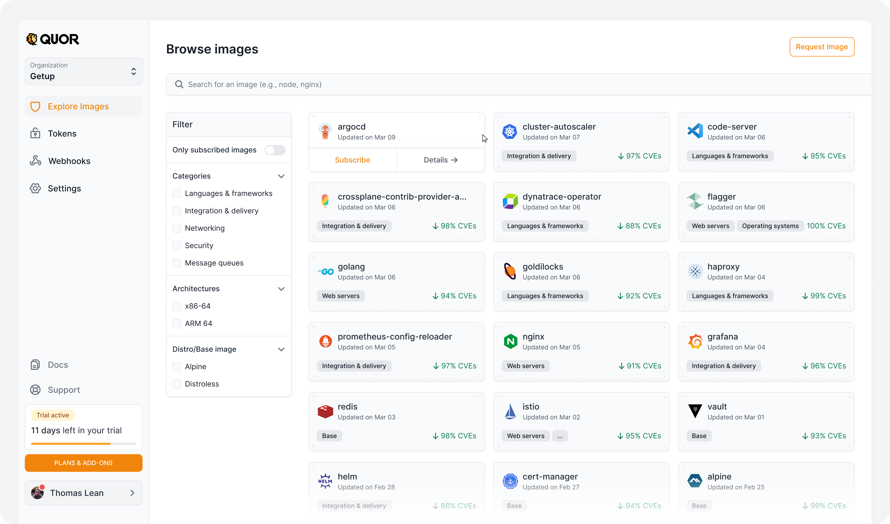
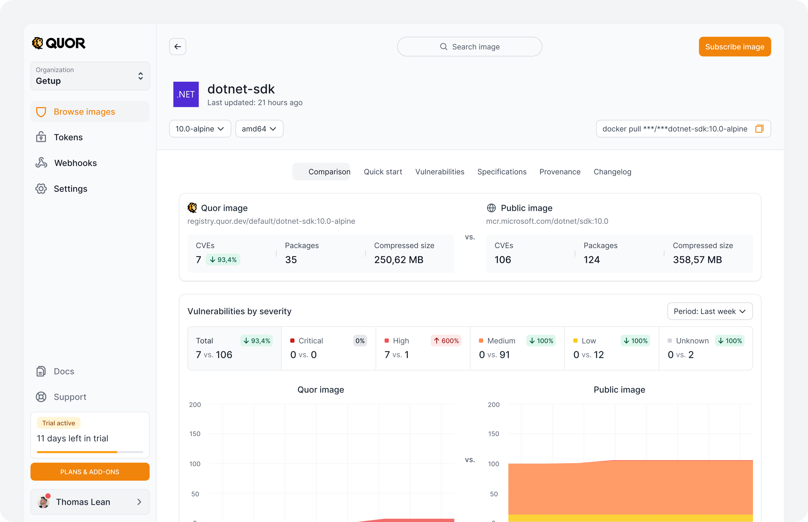
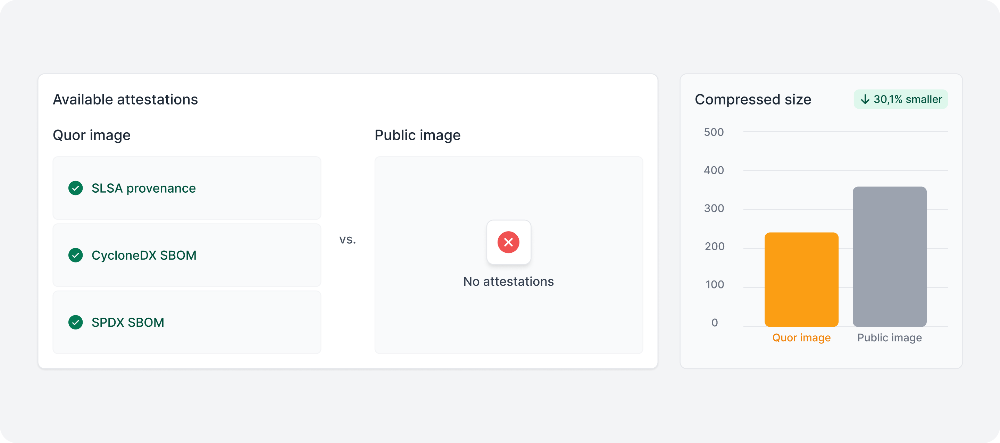
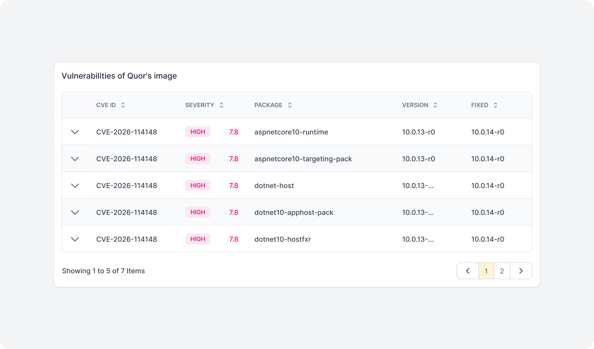
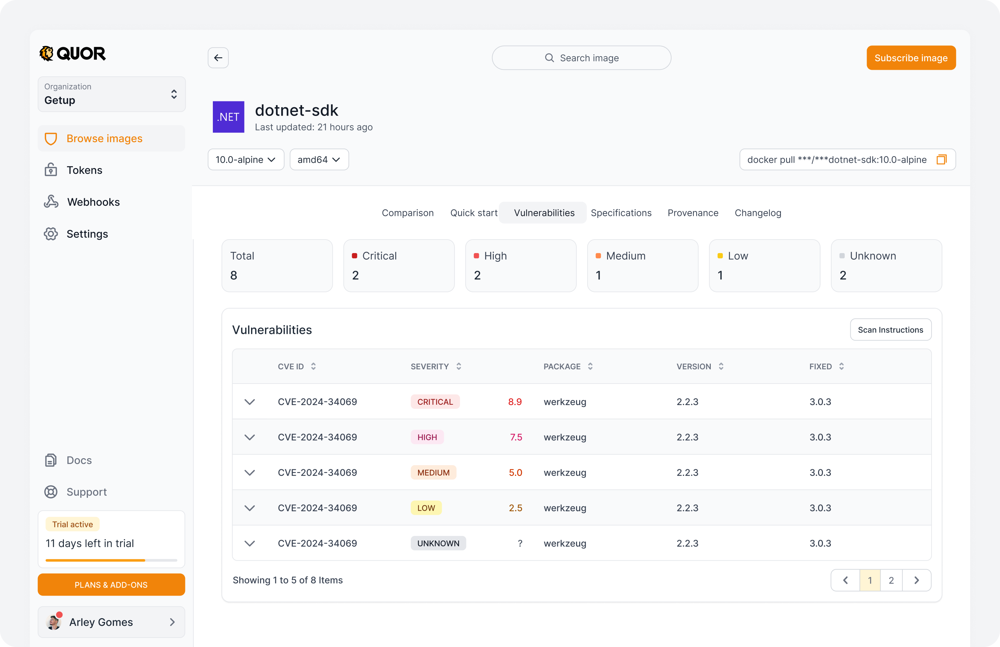
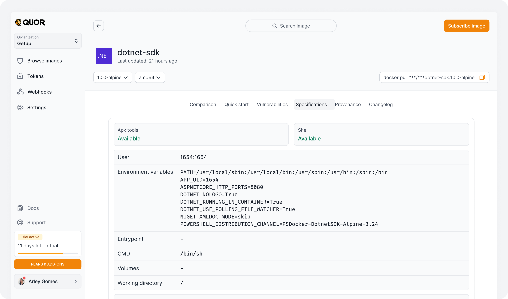
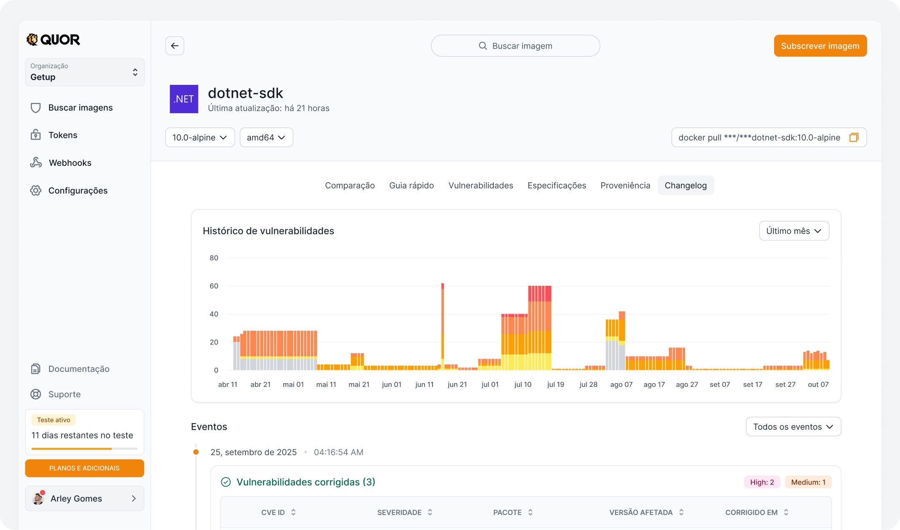

# Image catalog

## Browse images

The Browse images section displays the image catalog as cards, allowing you to quickly identify images and view the percentage reduction in vulnerabilities compared to the public image.

For each image, the following actions are available:

- **Subscribe to image** → for images available in your current plan;
- **Contact us** → for images available only on the Enterprise plan (after the Trial);
- **`docker pull` command** → for images you have already subscribed to and are ready to use.

!!! note "Important"

    The image path (required for `docker pull`) is only displayed after you subscribe to the image.

In addition to the image list, the page provides several options for finding specific images:

- **Text search:** Search for images directly by name (e.g., `node`, `nginx`, `argocd`).
- **Only subscribed images:** Toggle the view to display only images that your organization is actively subscribed to.
- **Categories:** Filter the catalog by use case (_Languages & frameworks_, _Integration & delivery_, _Networking_, _Security_, _Message queues_, etc.).
- **Architectures:** Filter images by processor architecture (_x86-64_, _ARM 64_).
- **Distro/Base image:** Filter images by their base Linux distribution (e.g., _Alpine_, _Distroless_).

## Image details

When you click on an image, you access the details page with complete information organized in tabs.

In the header, you can select the **version** and **architecture** you want. These selections set the context for the information shown in every tab, so you can review the data for a specific version without selecting it again in each section.

### Image comparison

Compares the Quor hardened image with its public equivalent, so you can analyze differences in the number of known vulnerabilities, packages, and compressed size.

#### Comparison components

**Key metrics**

Shows the registry URL of each image and compares the following indicators:

- **CVEs:** total number of known vulnerabilities in each image and the percentage reduction achieved.
- **Packages:** number of packages and dependencies identified in each image.
- **Size:** compressed size of the images in megabytes (MB).

**Vulnerabilities by severity**

Shows how vulnerabilities are distributed across the _Critical_, _High_, _Medium_, _Low_, and _Unknown_ levels, comparing the number identified in each image.

You can also select the analysis period to see how the number of vulnerabilities has changed over time.

**Vulnerability trend charts**

Two charts show the vulnerability history of the Quor image and the corresponding public image over the selected period.

- They show how the number of identified CVEs has changed.
- They use colors that match the severity levels.

**Attestations and compliance**

The comparison also shows which security attestations and artifacts are available, such as SLSA Provenance, SBOMs in SPDX and CycloneDX formats, and VEX statements.

This helps you identify which composition, origin, and integrity evidence is available for each image.

**Compressed size comparison**

A bar chart shows the size difference between the images, including the percentage reduction achieved by the Quor image.

**Vulnerability details**

The vulnerabilities section lists the CVEs identified in each image, including their identifiers and severity levels.

For a more detailed analysis of the vulnerabilities in the Quor image, use the [**Vulnerabilities**](#vulnerabilities) tab.

### Vulnerabilities

Shows the known vulnerabilities identified in the selected image version, with severity indicators and a detailed list of CVEs.

At the top, a summary shows the total number of vulnerabilities, broken down into the _Critical_, _High_, _Medium_, _Low_, and _Unknown_ levels.

The table shows:

- **CVE ID:** identifier of the vulnerability.
- **Severity:** rating and score of the vulnerability.
- **Package:** component associated with the CVE.
- **Version:** version of the affected package.
- **Fixed version:** version of the package that contains the fix, when available.

Expand a vulnerability to see additional information that helps you analyze the affected component and the characteristics of the CVE.

To understand the indicators shown, see [Vulnerability attributes](vulnerability-attributes.md).

### Specifications

Shows the technical characteristics and configuration of the selected image version.

This section shows whether tools such as Shell and APK Tools are available, along with configuration such as:

- **User:** user configured to run the container.
- **Environment variables:** environment variables defined in the image.
- **Entrypoint and CMD:** container startup configuration.
- **Volumes:** volumes declared in the image.
- **Working directory:** configured working directory.

You can also view and copy the specifications in JSON format.

### Provenance

Provenance information for the image, attesting to its origin and integrity. For all images and versions, this evidence set includes SBOM, signature, provenance attestations, and VEX statements to add exploitability context to vulnerability analysis.

To view and download the image SBOM, see [SBOM in Quor](sbom.md#sbom-in-quor).

### Changelog

The Changelog shows the history of vulnerabilities and events related to image updates over time.

**Vulnerability history**

A chart shows how the number of known vulnerabilities in the image has changed, broken down by severity.

You can select the analysis period to track changes in the number of identified CVEs over time.

**Events**

Below the chart, a timeline lists the recorded events in chronological order.

Each event shows the date, time, and changes identified in the image, including detected or fixed vulnerabilities.

Vulnerability events include information such as CVE ID, severity, affected package, version, and fixed version, when available.

You can also use the event filter to view specific categories of changes.

## Requesting new images

The Quor catalog is continuously expanded, with new images added in regular cycles. Additionally, users can request the inclusion of specific images.

### Request criteria

Requests are evaluated according to the following requirements:

- The project must be open source;
- The license must be compatible with redistribution;
- The requested version must be under active security support (not EOL).

!!! note

    Support verification is based on [endoflife.date](https://endoflife.date).
