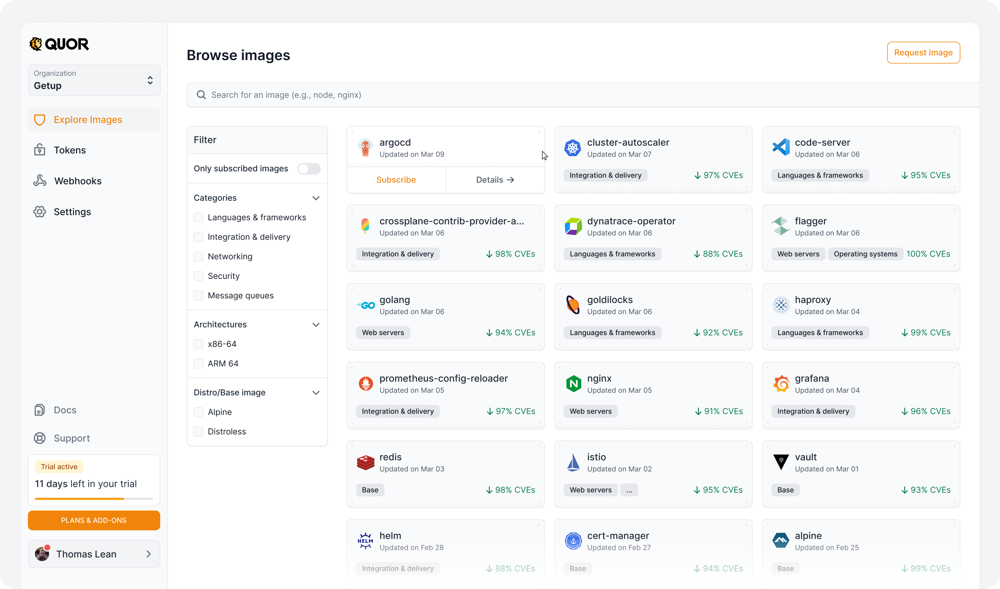
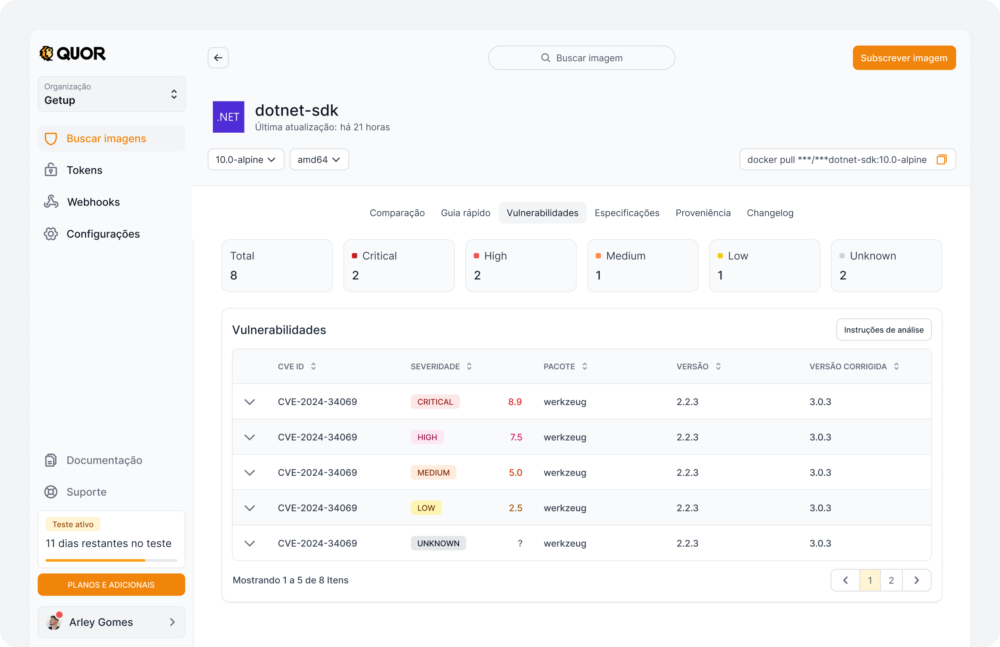
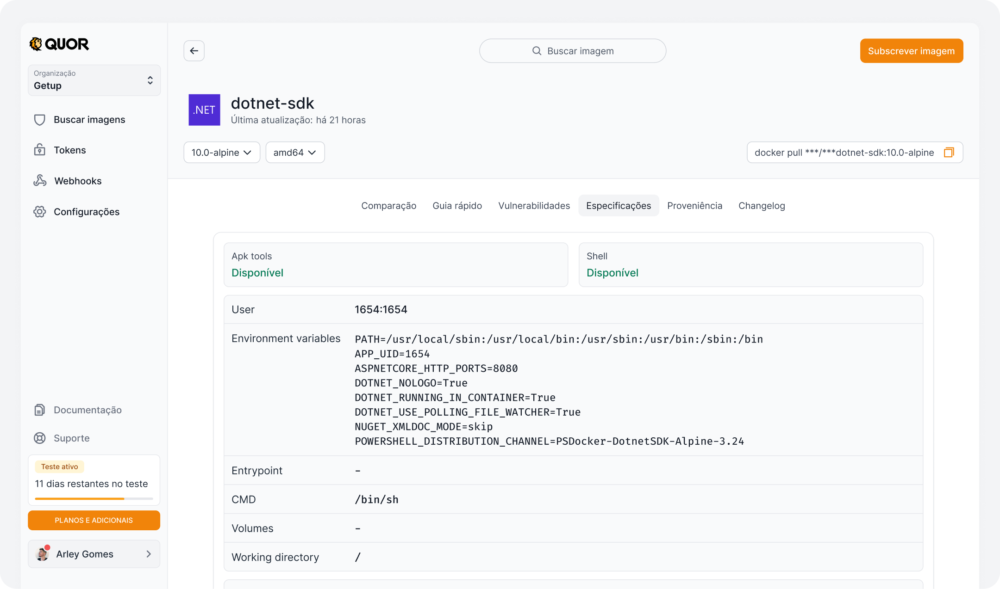
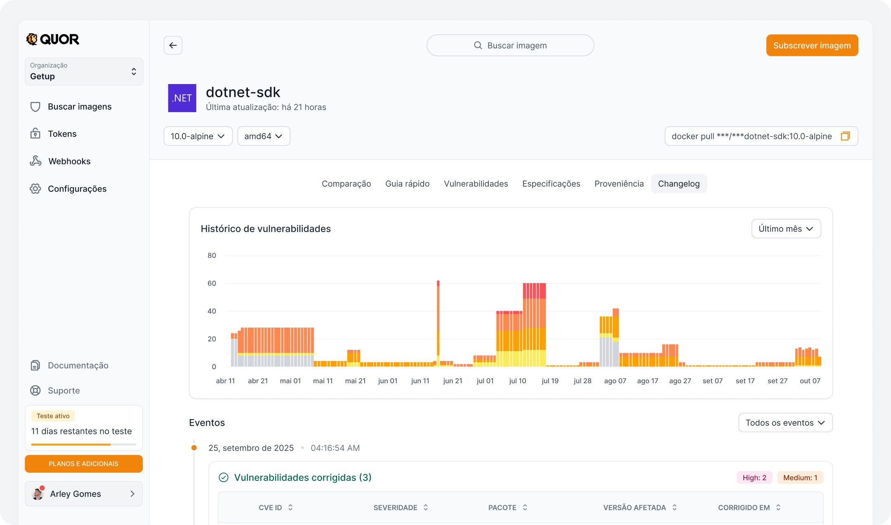

# Catálogo de imagens

## Browse images

A seção Browse images exibe o catálogo de imagens em formato de cards, permitindo a identificação rápida e o acesso à porcentagem de redução de vulnerabilidades em relação a imagem pública.

Para cada imagem, tem-se a seguintes ações disponíveis:

- **Subscrever imagem** → para imagens disponíveis no seu plano;
- **Contate-nos** → para imagens disponíveis apenas no plano Enterprise (pós Trial);
- **Comando docker pull** → para imagens já subscritas e prontas para uso.

!!! note "Importante"

    O path da imagem (necessário para o docker pull) só é exibido após a subscrição.

Além da lista, a tela oferece recursos para localizar imagens específicas.

- **Busca por texto:** Permite pesquisar imagens diretamente pelo nome (ex.: node, nginx, argocd).
- **Mostrar imagens subscritas:** Alterna a visualização para exibir apenas as imagens com inscrição ativa na sua organização.
- **Categorias:** Filtra o catálogo por caso de uso (_Languages & frameworks_, _Integration & delivery_, _Networking_, _Security_, _Message queues_, etc.).
- **Arquteturas:** Filtra as imagens por arquitetura de processador (_x86-64_, _ARM 64_).
- **Distro/Imagem base:** Filtra imagens pela distribuição Linux base (ex.: _Alpine_, _Distroless_).

## Detalhes da imagem

Ao clicar em uma imagem, você acessa a página de detalhes com informações completas organizadas em abas.

No cabeçalho, é possível selecionar a **versão** e a **arquitetura** desejadas. Essas seleções definem o contexto das informações exibidas em todas as abas, permitindo consultar os dados de uma versão específica sem precisar selecioná-la novamente em cada seção.

### Comparação de imagens

Apresenta uma comparação entre a imagem hardened do Quor e sua equivalente pública, permitindo analisar diferenças na quantidade de vulnerabilidades conhecidas, pacotes e tamanho comprimido.

#### Componentes da comparação

**Métricas principais**

Apresenta o endereço de registro (_registry URL_) de cada imagem e compara os seguintes indicadores:

- **CVEs:** quantidade total de vulnerabilidades conhecidas em cada imagem e o percentual de redução obtido.
- **Pacotes:** quantidade de pacotes e dependências identificados em cada imagem.
- **Tamanho:** tamanho comprimido das imagens em megabytes (MB).

**Vulnerabilidades por severidade**

Apresenta a distribuição das vulnerabilidades entre os níveis _Critical_, _High_, _Medium_, _Low_ e _Unknown_, comparando a quantidade identificada em cada imagem.

Também é possível selecionar o período de análise para visualizar como o número de vulnerabilidades evoluiu ao longo do tempo.

**Gráficos de evolução temporal**

Dois gráficos apresentam o histórico de vulnerabilidades da imagem Quor e da imagem pública correspondente durante o período selecionado.

- Exibem a evolução da quantidade de CVEs identificadas.
- Utilizam cores correspondentes aos níveis de severidade.

**Atestados e conformidade**

A comparação também apresenta informações sobre a disponibilidade de atestados e artefatos de segurança, como SLSA Provenance, SBOM nos formatos SPDX e CycloneDX e declarações VEX.

Essas informações ajudam a identificar quais evidências de composição, origem e integridade estão disponíveis para cada imagem.

**Comparativo do tamanho comprimido**

Um gráfico de barras apresenta a diferença de tamanho entre as imagens, incluindo o percentual de redução obtido pela imagem Quor.

**Detalhes de vulnerabilidades**

A seção de vulnerabilidades permite consultar as CVEs identificadas em cada imagem, incluindo seus identificadores e níveis de severidade.

Para uma análise mais detalhada das vulnerabilidades presentes na imagem Quor, utilize a aba [**Vulnerabilidades**](#vulnerabilidades).

### Vulnerabilidades

Apresenta as vulnerabilidades conhecidas identificadas na versão selecionada da imagem, com indicadores de severidade e uma lista detalhada das CVEs.

Na parte superior, é exibido um resumo da quantidade total de vulnerabilidades, distribuídas entre os níveis _Critical_, _High_, _Medium_, _Low_ e _Unknown_.

A tabela permite consultar:

- **CVE ID:** identificador da vulnerabilidade.
- **Severidade:** classificação e pontuação da vulnerabilidade.
- **Pacote:** componente associado à CVE.
- **Versão:** versão do pacote afetado.
- **Versão corrigida:** versão do pacote que contém a correção, quando disponível.

Ao expandir uma vulnerabilidade, é possível consultar informações adicionais para auxiliar na análise do componente afetado e das características da CVE.

Para entender os indicadores apresentados, consulte a documentação de [Atributos de uma vulnerabilidade](vulnerability-attributes.md).

### Especificações (Specifications)

Apresenta as características técnicas e configurações da versão selecionada da imagem.

A seção informa a disponibilidade de ferramentas como Shell e APK Tools, além de configurações como:

- **User:** usuário configurado para execução.
- **Environment variables:** variáveis de ambiente definidas na imagem.
- **Entrypoint e CMD:** configurações de inicialização do container.
- **Volumes:** volumes declarados na imagem.
- **Working directory:** diretório de trabalho configurado.

Também é possível consultar e copiar as especificações em formato JSON.

### Proveniência (Provenance)

Informações de proveniência da imagem, atestando sua origem e integridade. Para todas as imagens e versões, esse conjunto inclui SBOM, assinatura, atestados de proveniência e declarações VEX para adicionar contexto de explorabilidade na análise de vulnerabilidades.

Para consultar e baixar o SBOM da imagem, veja [SBOM no Quor](sbom.md#sbom-no-quor).

### Changelog

O Changelog apresenta o histórico de vulnerabilidades e eventos relacionados às atualizações da imagem ao longo do tempo.

**Histórico de vulnerabilidades**

Um gráfico apresenta a evolução da quantidade de vulnerabilidades conhecidas da imagem, distribuídas por severidade.

É possível selecionar o período de análise para acompanhar as mudanças no número de CVEs identificadas ao longo do tempo.

**Eventos**

Abaixo do gráfico, uma timeline apresenta os eventos registrados, organizados cronologicamente.

Cada evento informa a data, o horário e as alterações identificadas na imagem, incluindo vulnerabilidades detectadas ou corrigidas.

Os eventos de vulnerabilidades apresentam informações como CVE ID, severidade, pacote afetado, versão e versão corrigida, quando disponível.

Também é possível utilizar o filtro de eventos para consultar categorias específicas de alterações.

## Solicitar novas imagens

O catálogo do Quor é expandido continuamente, com novas imagens adicionadas em ciclos regulares. Além disso, usuários podem solicitar a inclusão de imagens específicas.

### Critérios para solicitação

As solicitações são avaliadas de acordo com os seguintes requisitos:

- O projeto deve ser open source;
- A licença precisa ser compatível com redistribuição;
- A versão solicitada deve estar em suporte ativo de segurança (não EOL).

!!! note

    A verificação de suporte é feita com base em [endoflife.date](https://endoflife.date).
