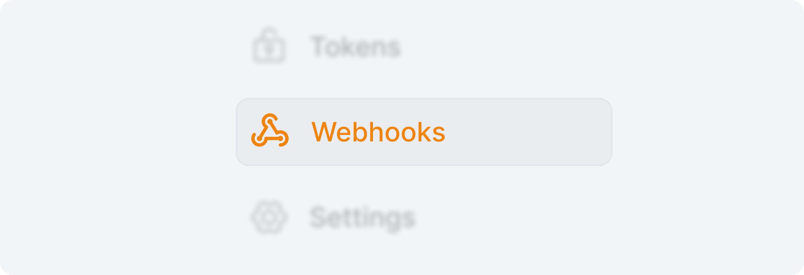
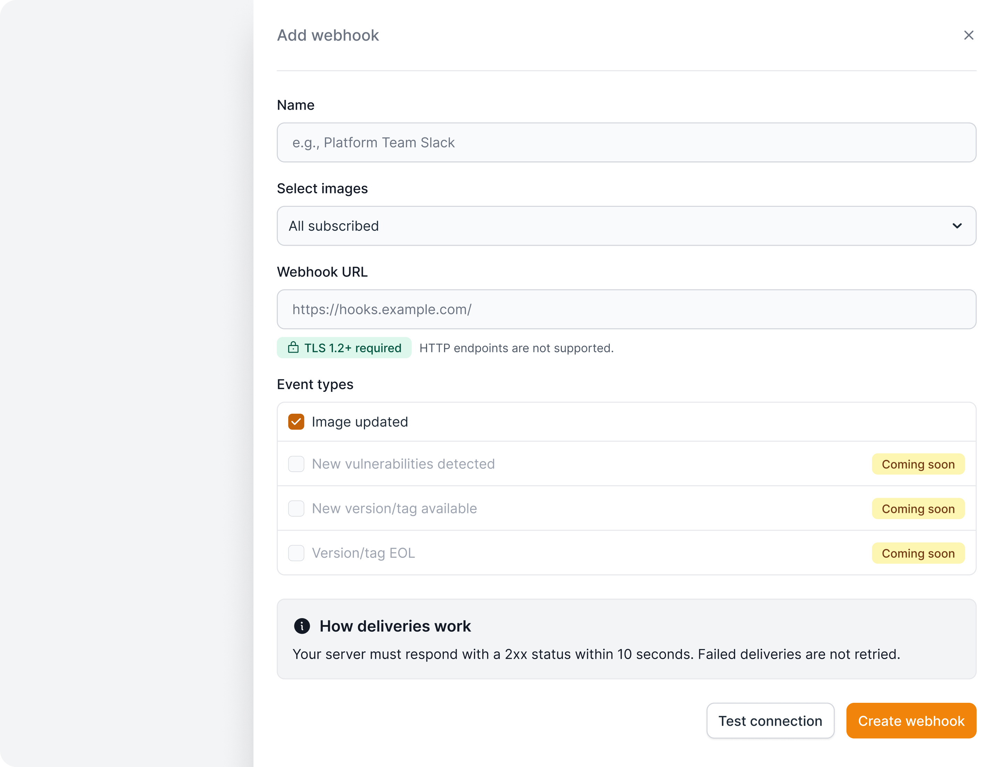
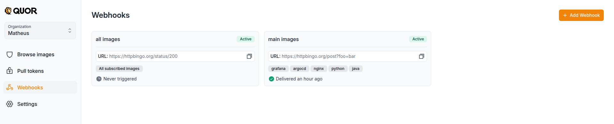
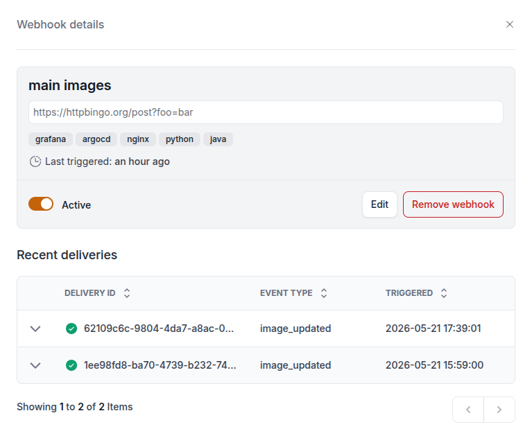
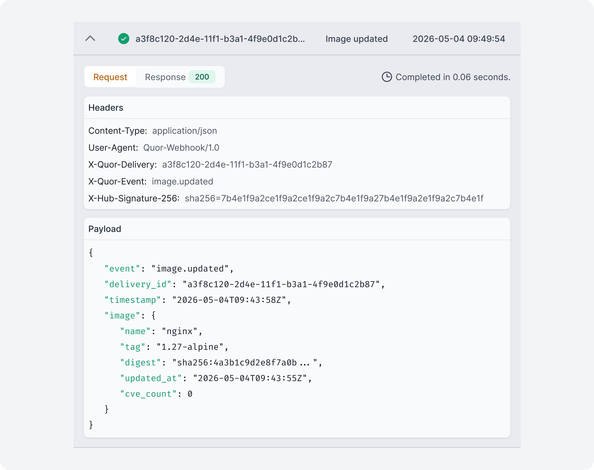

# Webhooks

Webhooks permitem que serviços externos sejam notificados quando eventos acontecem no Quor.
Isso pode ser usado para automatizar fluxos de trabalho ou disparar ações fora da plataforma.

Um caso de uso comum é notificar o time quando uma imagem subscrita é atualizada, permitindo reconstruir aplicações ou reimplantar workloads com a versão mais recente. Assim, o ambiente passa menos tempo rodando imagens afetadas por CVEs depois que a correção já está disponível no catálogo.

## Como funciona

Quando um dos eventos selecionados acontece, o Quor envia uma requisição HTTPS POST com um payload JSON para a URL configurada no webhook.

O Quor segue a especificação [Standard Webhooks](https://www.standardwebhooks.com/) para assinar as entregas e permitir que o destinatário verifique sua autenticidade.

Seu servidor deve:

- Escutar em HTTPS (HTTP sem criptografia não é suportado)
- Suportar TLS 1.2+
- Responder com um status 2xx em até 5 segundos
- Ser acessível publicamente (IPs internos/privados são rejeitados após a resolução do DNS)

Comportamento adicional:

- As entregas não são repetidas automaticamente.
- Apenas os primeiros 10 KB do corpo da resposta são armazenados para fins de depuração. Respostas não textuais não são armazenadas.

## Eventos suportados

Atualmente suportados:

- **Imagem atualizada** — disparado quando qualquer versão/tag de uma imagem subscrita é atualizada.

Em breve:

- Novas vulnerabilidades
- Novas versões
- Fim de vida (EOL)

## Criando um webhook

1. No Quor, navegue até **Webhooks** na barra lateral esquerda.
    
    
   
2. Clique em **Adicionar webhook**.
    
    
    
3. Informe um nome para identificar o webhook e uma URL HTTPS válida
4. Selecione quais imagens subscritas e eventos devem disparar o webhook.
!!! info "Importante"
    Se a opção "Todas as imagens subscritas" estiver selecionada, imagens subscritas após a criação do webhook também serão consideradas.
5. Opcionalmente, clique em **Testar conexão** para validar o endpoint antes de salvar.
6. Crie o webhook.
7. Guarde a secret exibida após a criação. Ela será necessária para [verificar a assinatura das entregas](#verificando-a-assinatura).



Após a criação, o Quor notificará seu endpoint sempre que os eventos selecionados ocorrerem para as imagens especificadas.

## Gerenciando webhooks

Todos os webhooks configurados em sua organização são listados na página de Webhooks.



Ao abrir um webhook, você pode:

* Editar a configuração
* Habilitar ou desabilitar entregas
* Excluir o webhook
* Visualizar entregas recentes

## Listando entregas

As entregas recentes são exibidas na parte inferior da página de detalhes do webhook.



Ao abrir uma entrega, você pode inspecionar as informações completas da requisição e da resposta,
incluindo detalhes da requisição e da resposta (corpo, cabeçalhos, status).



## Payload

O payload contém os digests anterior e atual da imagem,
permitindo identificar mudanças tanto no nível do índice da imagem quanto no nível do manifesto específico de cada arquitetura.

```json
{
  "type": "image.updated",
  "timestamp": "2026-10-27T16:37:06-03:00",
  "data": {
    "registry": "registry.quor.dev",
    "image": "default/image",
    "tag": "1.2-alpine",
    "ui_url": "https://app.quor.dev/images/123/default/image/details",
    "digest": "sha256:843b9c5e4dd478148afceeb6a8f2b0797fe041dbf88b38954d345e2618162c36",
    "manifests": [
      {
        "architecture": "amd64",
        "digest": "sha256:0b98bc2ee3ff2010ff6c0042e27b254f6f3ad7590bb84d259f8a4483f57fb2ae"
      }
    ],
    "previous_digest": "sha256:ee25cd7ca070d8672563a17e030016ec2561cb7293008598b54eed85300d1a55",
    "previous_manifests": [
      {
        "architecture": "amd64",
        "digest": "sha256:e5b5f72a2b189a3292f78b8a3502e74ae8c5294946e62fcb5ee08e2b6e84adae"
      }
    ]
  }
}
```

## Verificando a assinatura

O Quor assina as entregas seguindo a especificação [Standard Webhooks](https://www.standardwebhooks.com/). 
Recomendamos verificar a assinatura recebida antes de processar o payload.

Cada entrega inclui os seguintes cabeçalhos HTTP:

| Cabeçalho           | Descrição                                                                    |
|---------------------|------------------------------------------------------------------------------|
| `webhook-id`        | Identificador único do evento, útil para evitar o processamento duplicado.   |
| `webhook-timestamp` | Timestamp Unix, em segundos, usado na assinatura da entrega.                 |
| `webhook-signature` | Assinatura criptográfica usada para verificar a autenticidade da requisição. |

Utilize a secret fornecida na criação do webhook e uma biblioteca compatível com Standard Webhooks para verificar a assinatura. 
A validação deve usar o corpo original da requisição, antes de qualquer transformação do JSON.

Também recomendamos verificar se o timestamp está dentro de uma janela de tempo aceitável para reduzir o risco de ataques de repetição (*replay attacks*).

### Bibliotecas

O Standard Webhooks disponibiliza implementações de referência para diferentes linguagens:

- [Python](https://github.com/standard-webhooks/standard-webhooks/tree/main/libraries/python) - `standardwebhooks` no PyPi.
- [JavaScript/TypeScript](https://github.com/standard-webhooks/standard-webhooks/tree/main/libraries/javascript) - `standardwebhooks` no NPM.
- [Java/Kotlin](https://github.com/standard-webhooks/standard-webhooks/tree/main/libraries/java) - `com.standardwebhooks:standardwebhooks` no Maven Central.
- [Rust](https://github.com/standard-webhooks/standard-webhooks/tree/main/libraries/rust) - `standardwebhooks` no crates.io.
- [Go](https://github.com/standard-webhooks/standard-webhooks/tree/main/libraries/go) - `github.com/standard-webhooks/standard-webhooks/libraries/go`.
- [Ruby](https://github.com/standard-webhooks/standard-webhooks/tree/main/libraries/ruby) - `standardwebhooks` no RubyGems.
- [PHP](https://github.com/standard-webhooks/standard-webhooks/tree/main/libraries/php)
- [C#](https://github.com/standard-webhooks/standard-webhooks/tree/main/libraries/csharp) - `StandardWebhooks.StandardWebhooks` no nuget.
- [Elixir](https://github.com/standard-webhooks/standard-webhooks/tree/main/libraries/elixir)

Consulte o [repositório oficial do Standard Webhooks](https://github.com/standard-webhooks/standard-webhooks) para ver as implementações disponíveis e as instruções de uso.

## Disponibilidade

Os limites de webhooks dependem do plano da sua organização:

| Plano             |  Webhooks |
|-------------------|----------:|
| Trial (14 dias)   |         1 |
| Free              |         0 |
| Enterprise        | Ilimitado |
